<div align="center">

# Variational methods in soft matter

**An open book on the Onsager principle, taught through worked problems — with every variational result
checked against an exact or numerical solution.**

[](https://github.com/ktwyw/onsager-variational-methods/actions/workflows/tests.yml)
[](https://ktwyw.github.io/onsager-variational-methods/)
[](pyproject.toml)
[](#whats-inside)
[](LICENSE)
[](DATA_LICENSE.md)

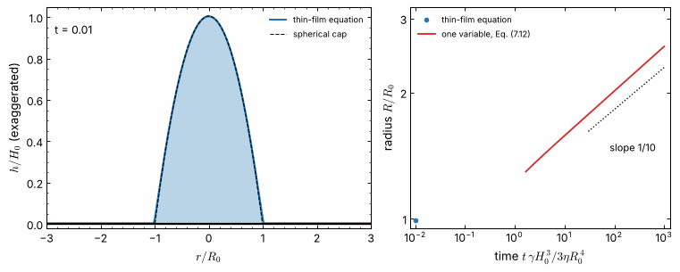

<sub>One variable against a partial differential equation. A drop spreads on a solid that it wets. Left: the profile from the thin-film equation and the spherical cap fitted to it. Right: the radius from the thin-film equation (dots) and from the Onsager principle with the radius as the only variable (line), which gives Tanner's law, R ∝ t<sup>1/10</sup> (Chapter 7). (<code>scripts/make_readme_drop_animation.py</code>)</sub>

</div>

The slow motion of soft matter (colloids, polymers, gels, liquid films, liquid crystals) is decided by a
balance between thermodynamic forces and friction. The Onsager principle states that balance as a
minimum: the rates of change are those that minimise the **Rayleighian**, the sum of the dissipation
function Φ and the rate of change of the free energy *A*. Two scalar functions replace a list of forces,
the resulting equations obey the second law and Onsager's reciprocal relations by construction, and a
minimum can be approached with trial functions when the exact solution is out of reach. This repository
teaches the method through worked problems. It contains **Part I: 5 chapters** on the
principle itself, **Part II: 4 chapters on liquids and interfaces** (capillary rise and imbibition;
spreading of a droplet; coalescence and sintering; a drying droplet), **Part III: 5 chapters on soft
materials** (diffusion and sedimentation of colloids; swelling and squeezing of a gel; phase
separation; polymer dynamics; nematic liquid crystals), **worked solutions to all 56 exercises** in
[`solutions/`](solutions), a small tested Python module (**`onsager`**), and a list of
**[suggested references](docs/references.md)**. All 28 notebooks are stored executed.

> **Start in 60 seconds:** open [Chapter 1](notebooks/part1_principle/01_why_a_variational_principle.ipynb)
> here on GitHub (the notebooks are stored with their outputs), or go straight to
> [Chapter 5](notebooks/part1_principle/05_approximation_method.ipynb), where a diffusion problem is
> solved with one parameter and compared with the exact solution.

## Why this book?

- **One recipe, repeated.** Every problem is solved in the same steps: choose the slow variables, write
  the free energy *A*, write the dissipation function Φ, minimise Φ + d*A*/d*t*, solve and interpret.
- **Every result is checked.** Each variational result is compared with the exact or fully numerical
  solution of the same problem, so the reader sees how good a one- or two-parameter trial solution
  really is, and where it fails.
- **Pictures beside the theory.** Schematics, maps of the Rayleighian, velocity and flux fields are
  placed where the argument needs them: three figures in every chapter, more in the solutions.
- **Derivations are written out.** No step is left to the reader; the level is that of a physics or
  engineering graduate course, and no calculus of variations is assumed. Each chapter ends with four
  exercises, and every exercise has a sample solution, derived and then checked by computation.
- **Honest about accuracy.** Chapter 5 shows which outputs of a trial solution can be trusted (scaling
  laws, integrated quantities) and which cannot (local gradients, coefficients to better than a few per
  cent), including a case where adding a parameter does not improve the answer.

## What the checks show

<p align="center">
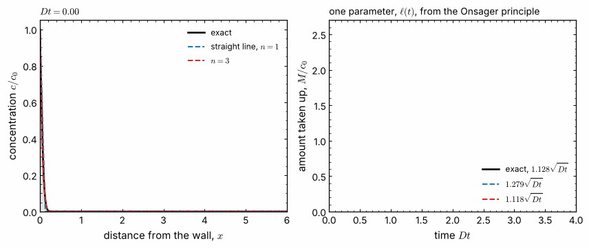
</p>

<sub>The approximation method of Chapter 5. A solute diffuses into a liquid from a wall. The trial profiles have a single parameter, the penetration length ℓ(t), and the Onsager principle says how it grows. Both give the exact √(Dt) law; the amount taken up is 13 % high for a straight line and 1 % low for a cubic profile. (<code>scripts/make_readme_animation.py</code>)</sub>

<p align="center">
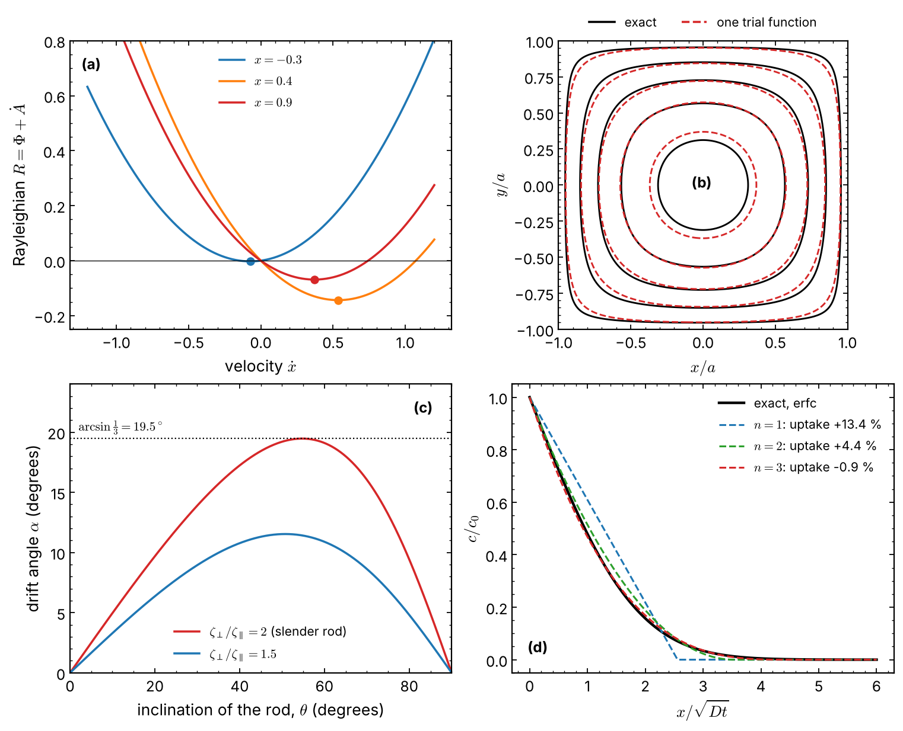
</p>

**(a)** The Rayleighian of a particle in a viscous fluid is a parabola in the velocity; its minimum is
the velocity the particle takes. **(b)** Flow in a square duct: one trial function gives the flow rate
to 1.2 %, always from below. **(c)** A slender rod settling in a viscous liquid drifts sideways, by at
most arcsin(1/3) = 19.5°. **(d)** Diffusion into a half-space: trial profiles with the penetration
length given by the Onsager principle.

| Check | Variational result | Reference | Agreement |
|---|---|---|---|
| Flow rate in a square duct, 1 trial function | 5/9 = 0.5556 | 0.5623 (series) | −1.2 % |
| Flow rate in a square duct, 15 trial functions | 0.562303 | 0.562308 | −0.001 % |
| Largest drift angle of a slender rod | 19.4712° (numerical search) | arcsin(1/3) | to 4 decimals |
| Squeeze film, gap against time | kinetic equation | Stefan's law, closed form | 10⁻¹¹ |
| Particles in a harmonic trap | finite-volume solution | exact Gaussian | error falls as Δx² |
| Energy balance of a non-ideal solution | ∫2Φ d*t* | *A*(0) − *A*(*t*) | 2 × 10⁻⁴ |
| Uptake by diffusion, straight-line profile | 1.279 √(*Dt*) | 1.128 √(*Dt*) | +13.4 % |
| Uptake by diffusion, cubic profile | 1.118 √(*Dt*) | 1.128 √(*Dt*) | −0.9 % |
| Capillary rise, kinetic equation | numerical solution | exact *t*/τ = −*H* − ln(1 − *H*) | 3 × 10⁻⁹ |
| Capillary rise, energy balance | ∫2Φ d*t* | *A*(0) − *A*(*t*) | 6 × 10⁻¹² |
| Spreading drop, radius over three decades of time | kinetic equation for *R*(*t*) | thin-film equation | within 2 % |
| Spreading drop, equilibrium radius (partial wetting) | (4Ω/πθ<sub>e</sub>)<sup>1/3</sup> | thin-film equation | 0.5 % |
| Spreading drop, coefficient of the logarithm | 6 | 9 (Cox–Voinov) | not captured by a cap-shaped trial profile |
| Viscous gravity current (exercise) | *R*⁸ = (2¹⁰/3⁵π³) ρ*g*Ω³*t*/η | Huppert's similarity solution | exact |
| Coalescence of two cylinders, Frenkel's model | neck from a uniform compression | Hopper's exact solution | neck of half the radius reached 9 times too early |
| Coalescence, exact shapes and potential flow | friction of the flow | Hopper's exact solution | always larger, by a factor 4/3 to 3.3; times 1.4–2.5 too long |
| Last stage of coalescence (exercise) | rate γ/η*R* with a rotational term | Hopper's late-time rate | exact |
| Drying drop without line friction, radius | Man–Doi equation | thin-film equation with evaporation | within 0.006 *R*₀ (slow), 0.04 *R*₀ (fast) |
| Drying drop, deposit | particle paths in the cap | thin-film equation with solute transport | within 0.03 of the solute |
| Deposit peak for fast evaporation | numerical | Man and Doi's closed form | to 3 decimals |
| Dilute suspension settling | finite-volume solution | Mason and Weaver's exact series | 2 × 10⁻⁴, error ∝ Δ*z*² |
| Settling, exponential trial (*L*/ℓ<sub>g</sub> = 2) | mean height of the particles | exact series | within 0.0012 *L* |
| Settling, falling-front trial (*L*/ℓ<sub>g</sub> = 200) | mean height of the particles | exact series | within 0.003 *L* |
| Concentrated suspension, upper edge | numerical | Kynch, *U*₀*K*(φ₀) | within 0.008 *L* |
| Concentrated suspension, final state | numerical | equilibrium profile from the equation of state | 10⁻⁶ |
| Gel sheet and gel sphere, swelling | finite elements (discretised Rayleighian) | exact series | 5 × 10⁻⁶, error ∝ *N*⁻² |
| Gel sphere, slowest rate, 1 trial function (uniform dilation) | 15*K*/*fa*² for any *G* | exact, π²*K*/*fa*² to 15*K*/*fa*² | upper bound; exact for *G* ≫ *K* |
| Gel sphere, slowest rate, 3 trial functions | polynomial trial | exact root of Peters–Candau / Li–Tanaka condition | 3 × 10⁻⁵ (relative) |
| Gel sphere, surface hoop stress at the start | finite elements | −2*G*Π₀/*M* | within 3 % at *tK*/*fa*² = 10⁻⁴ |
| Spinodal decomposition, growth rates | numerical (Cahn–Hilliard) | Cahn's linear theory | 4 × 10⁻⁴ (relative) |
| Interfacial tension of a blend | relaxed numerical interface | ∫√(2κΔ*f*) d*φ* | 6 digits |
| Energy balance of phase separation | ∫2Φ d*t* | *A*(0) − *A*(*t*) | 8 × 10⁻⁸ |
| Saturated pattern, 1 Fourier mode | trial function | numerical | amplitude within 2–3 % |
| Coarsening in 2D | domain size | Lifshitz–Slyozov *t*¹ᐟ³ | local exponent 0.24–0.29 |
| Rouse chain, fluctuations | regression hypothesis | Brownian dynamics | ⟨u(t)·u(0)⟩ within 0.4 % of ⟨u²⟩, displacement within 2.2 % |
| Rouse chain, dumbbell trial | 12*k*/ζ*N*(*N*+1) | exact slowest rate | 22 % too fast for long chains; 3 trial functions to 3 × 10⁻⁷ |
| FENE chain in elongational flow | dumbbell trial | full chain, steady state | threshold 16 % late; extension within 0.04 |
| Twist Fréedericksz transition | finite differences | exact elliptic-integral twist | 2 × 10⁻⁵ |
| Twist cell, one-mode trial | *ȧ* = −*a* + *h*²*J*₁(2*a*) | exact twist | exact at threshold; exceeds π/2 for *h* > 2.35 |
| Director in a sheared cell | finite differences | small-Er limit; Leslie angle; exact wall layer | 4 digits in the wall layer |

## Gallery

Each chapter has three figures: two beside the theory they illustrate, and one that collects the checks.

| | |
|---|---|
| 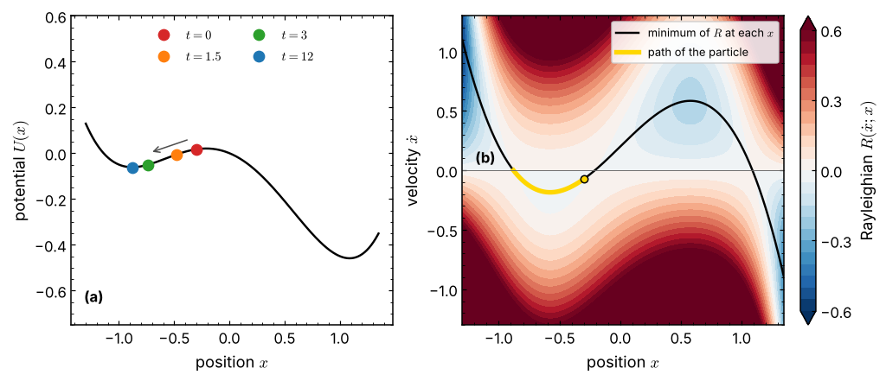<br>The Rayleighian as a map in position and velocity; the particle follows the line of minima ([Chapter 1](notebooks/part1_principle/01_why_a_variational_principle.ipynb)) | <br>Why an inclined rod drifts sideways: force diagram, and the same result as a minimum ([Chapter 2](notebooks/part1_principle/02_kinetic_equations.ipynb)) |
| <br>Velocity profiles in a film, a gap and a tube, and where the energy is dissipated ([Chapter 3](notebooks/part1_principle/03_writing_the_two_functions.ipynb)) | <br>Particles in a trap: the concentration in space and time, and the chemical potential flattening ([Chapter 4](notebooks/part1_principle/04_field_equations.ipynb)) |
| 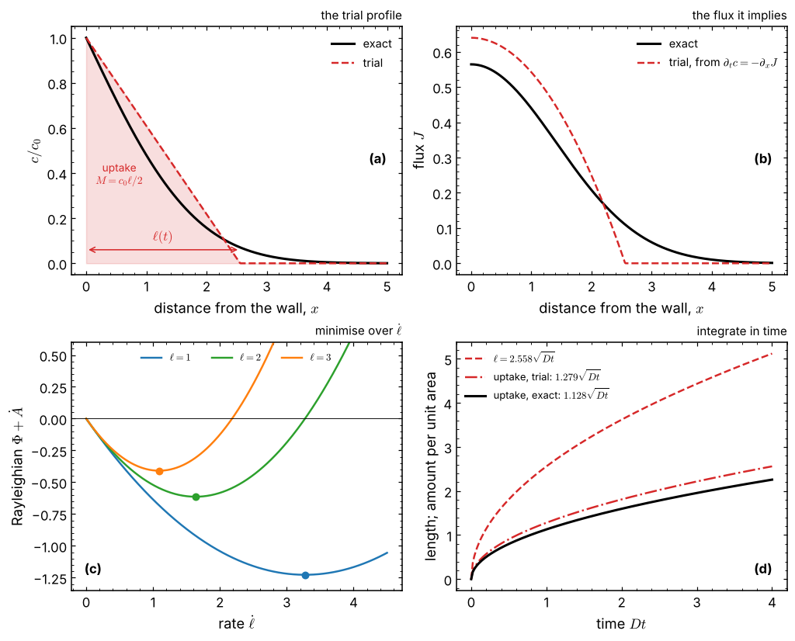<br>The four steps of the approximation method: trial profile, implied flux, the Rayleighian against the rate, and the result ([Chapter 5](notebooks/part1_principle/05_approximation_method.ipynb)) | <br>Capillary rise: where the overdamped description holds and where the column oscillates ([Chapter 6](notebooks/part2_liquids_interfaces/06_capillary_rise.ipynb)) |
| <br>Tanner's law: the radius of a spreading drop grows as the tenth root of the time ([Chapter 7](notebooks/part2_liquids_interfaces/07_spreading_droplet.ipynb)) | 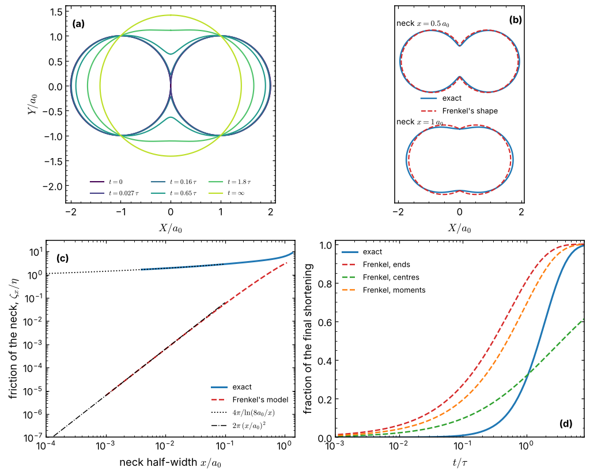<br>Coalescence of two viscous cylinders: Hopper's exact shapes, and why Frenkel's model runs ahead ([Chapter 8](notebooks/part2_liquids_interfaces/08_coalescence_sintering.ipynb)) |
| 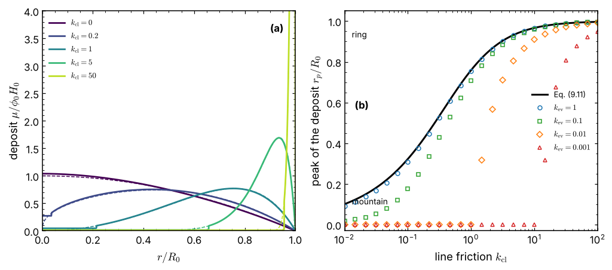<br>A drying drop: from a mountain to a coffee ring as the contact line is held more firmly ([Chapter 9](notebooks/part2_liquids_interfaces/09_drying_droplet.ipynb)) | 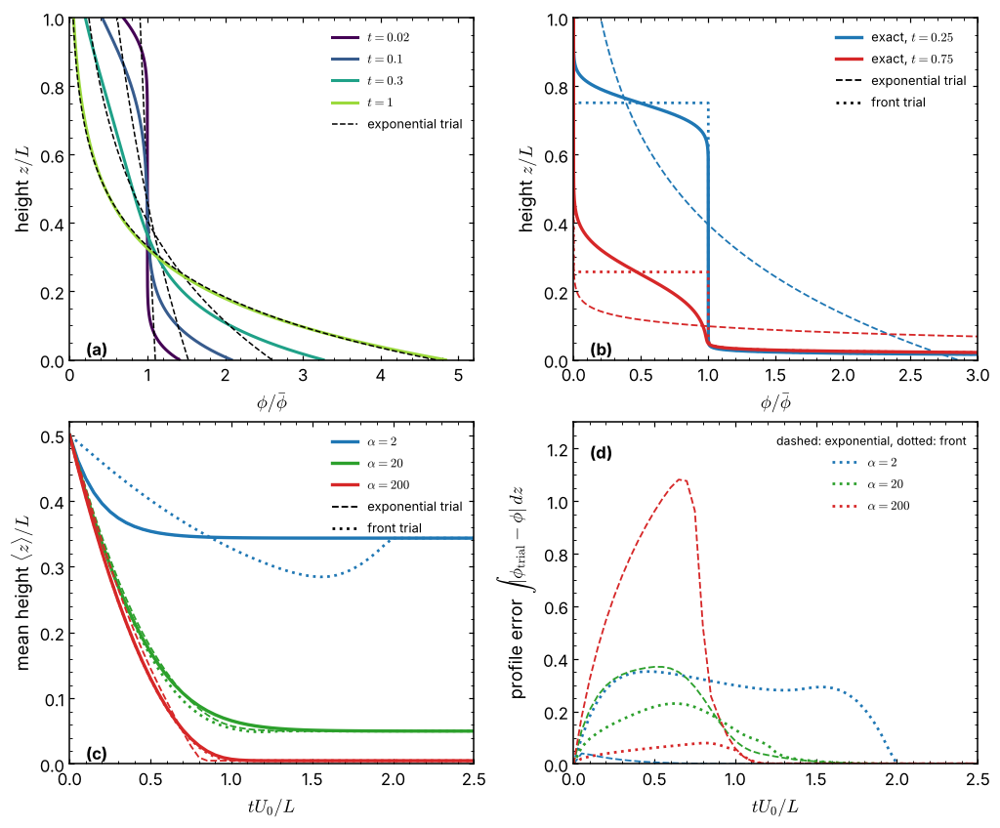<br>Settling of a suspension: a smooth trial is right when diffusion wins, a falling front when gravity does ([Chapter 10](notebooks/part3_soft_materials/10_diffusion_sedimentation.ipynb)) |
| 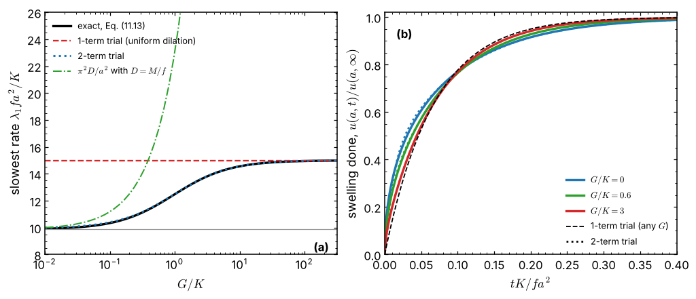<br>A swelling gel sphere: the bulk modulus sets the time, and one trial function shows why ([Chapter 11](notebooks/part3_soft_materials/11_gel_swelling.ipynb)) | 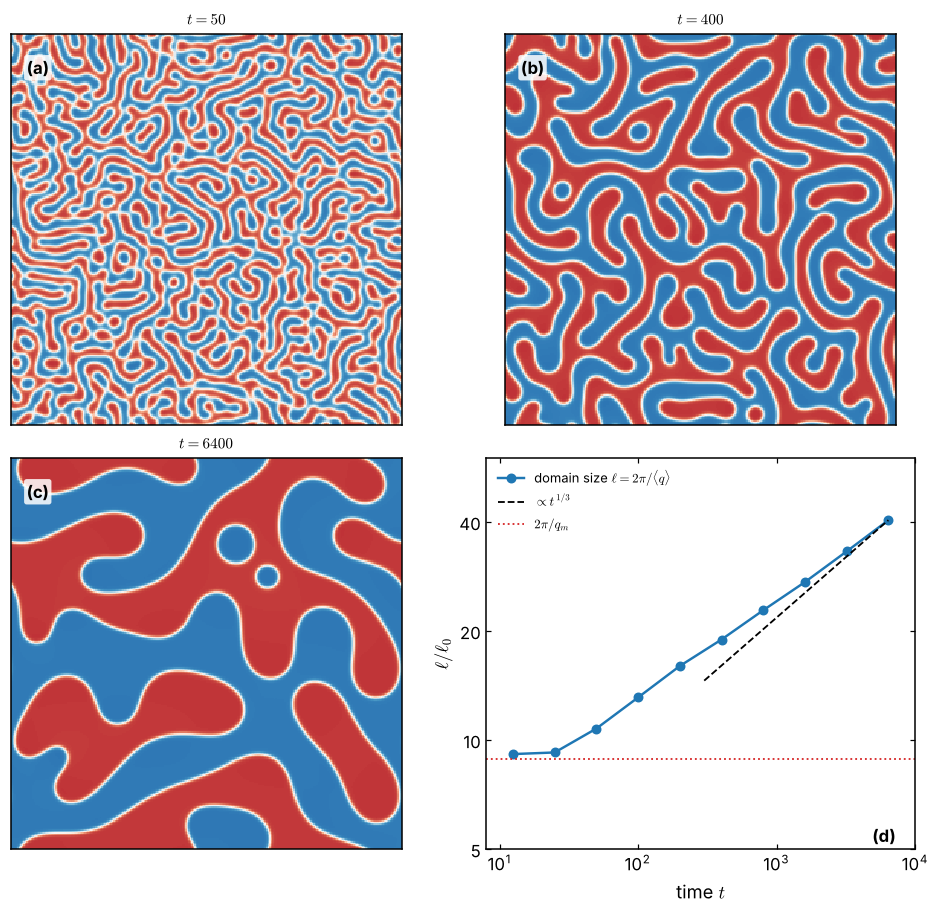<br>Phase separation: a pattern of the fastest wavelength coarsens as the cube root of time ([Chapter 12](notebooks/part3_soft_materials/12_phase_separation.ipynb)) |
| 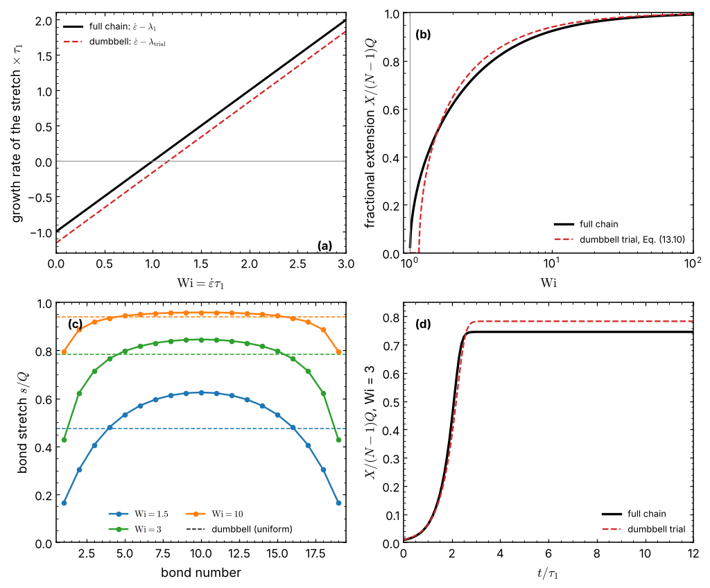<br>A chain in elongational flow: the dumbbell is a one-parameter trial ([Chapter 13](notebooks/part3_soft_materials/13_polymer_dynamics.ipynb)) | 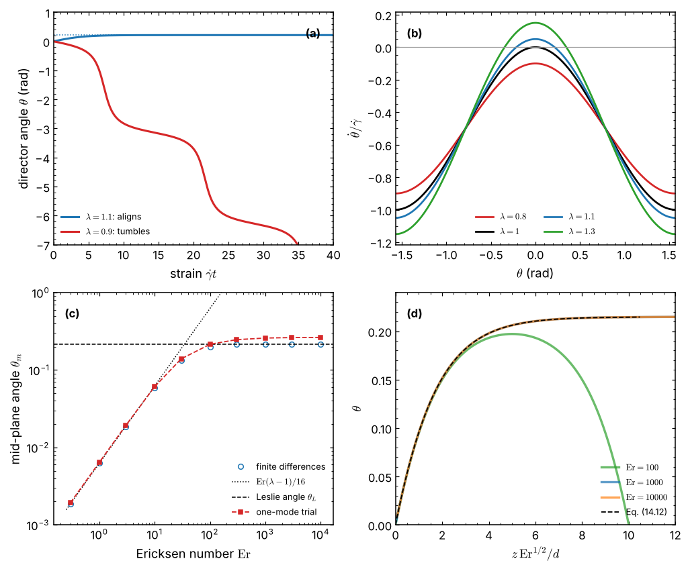<br>A nematic in shear flow: it aligns or tumbles, and forms wall layers in a cell ([Chapter 14](notebooks/part3_soft_materials/14_nematic_liquid_crystals.ipynb)) |

## Installation

```bash
git clone https://github.com/ktwyw/onsager-variational-methods.git
cd onsager-variational-methods
pip install -e ".[notebooks]"
jupyter lab
```

The notebooks also run without installation: each one adds the repository root to the path if the
module is not installed.

## Quick start

```python
import sympy as sp
import onsager as on

# two reservoirs joined by a narrow tube: three rates, two constraints
h1, h2, q = sp.symbols("h1 h2 q")
hdot1, hdot2, Q, p1, p2 = sp.symbols("hdot1 hdot2 Q p1 p2")
S1, S2, rho_g, R_h = sp.symbols("S1 S2 rho_g R_h", positive=True)

A = rho_g * (S1 * h1**2 + S2 * h2**2) / 2      # gravitational energy
Phi = R_h * Q**2 / 2                           # dissipation in the tube

eq = on.kinetic_equations(A, Phi, [h1, h2, q], [hdot1, hdot2, Q],
                          constraints=[S1 * hdot1 + Q, S2 * hdot2 - Q], multipliers=[p1, p2])
print(eq[Q])     # rho_g*(h1 - h2)/R_h   Poiseuille's law
print(eq[p1])    # h1*rho_g              the multiplier is the hydrostatic pressure
```

## What's inside

**Part I. The principle**

| Chapter | Topics | Checked against |
|---|---|---|
| [1. Why a variational principle](notebooks/part1_principle/01_why_a_variational_principle.ipynb) | the Rayleighian of a particle; minimum dissipation in Stokes flow; trial functions | force-balance solution; exact series for a square duct |
| [2. Onsager's kinetic equations](notebooks/part1_principle/02_kinetic_equations.ipynb) | friction matrix; reciprocal relations; d*A*/d*t* = −2Φ; a settling rod; two interacting spheres | closed-form drift angle; energy balance |
| [3. Writing the two functions](notebooks/part1_principle/03_writing_the_two_functions.ipynb) | catalogue of *A* and Φ; functional derivatives; Lagrange multipliers; the squeeze film | numerical derivative; exponential relaxation; Stefan's law |
| [4. From the principle to field equations](notebooks/part1_principle/04_field_equations.ipynb) | diffusion and the Einstein relation; Stokes; Darcy; Brinkman | exact solution in a harmonic trap; energy balance; exact channel profile |
| [5. The approximation method](notebooks/part1_principle/05_approximation_method.ipynb) | trial profiles; a dynamical shape parameter; the Onsager–Machlup integral; what to trust | exact error-function solution |

**Part II. Liquids and interfaces**

| Chapter | Topics | Checked against |
|---|---|---|
| [6. Capillary rise and imbibition](notebooks/part2_liquids_interfaces/06_capillary_rise.ipynb) | Lucas–Washburn law; Jurin height; inertia and oscillations; imbibition into porous materials | exact solution of the kinetic equation; energy balance; Bosanquet's equation with inertia |
| [7. Spreading of a droplet](notebooks/part2_liquids_interfaces/07_spreading_droplet.ipynb) | the unbalanced Young force; friction of a liquid wedge and its logarithm; Tanner's law; partial wetting; the thin-film equation | numerical solution of the thin-film equation with a precursor film; Cox–Voinov law |
| [8. Coalescence and sintering of viscous drops](notebooks/part2_liquids_interfaces/08_coalescence_sintering.ipynb) | Frenkel's model; shapes and flows that do not fit; a consistent trial and the minimum principle; spheres and Frenkel's law | Hopper's exact solution for two cylinders |
| [9. A drying droplet](notebooks/part2_liquids_interfaces/09_drying_droplet.ipynb) | flow driven by evaporation; contact-line friction; the Man–Doi equation; coffee rings, volcanoes and mountains | thin-film equation with evaporation and solute transport; Man and Doi's closed form |

**Part III. Soft materials**

| Chapter | Topics | Checked against |
|---|---|---|
| [10. Diffusion and sedimentation of colloids](notebooks/part3_soft_materials/10_diffusion_sedimentation.ipynb) | osmotic pressure and particle–solvent friction; collective diffusion and hindered settling; sedimentation equilibrium; choosing a trial that has the right physics | Mason and Weaver's exact solution; Kynch's front velocity; the equilibrium profile of hard spheres |
| [11. Swelling and squeezing of a gel](notebooks/part3_soft_materials/11_gel_swelling.ipynb) | the network and its solvent; stress and diffusion; a sheet swelling or squeezed; a sphere, Tanaka and Fillmore, and the shear modulus; trial functions as bounds | exact series for a sheet and a sphere; finite elements |
| [12. Phase separation](notebooks/part3_soft_materials/12_phase_separation.ipynb) | Flory–Huggins and the gradient term; the Cahn–Hilliard equation; phase diagram and interface; spinodal decomposition; Fourier-mode trials; coarsening | Cahn's linear theory; exact interface and tension; energy balance; numerical solution in 1D and 2D |
| [13. Polymer dynamics](notebooks/part3_soft_materials/13_polymer_dynamics.ipynb) | the Rouse chain; normal modes; fluctuations and the regression hypothesis; stress relaxation; the dumbbell as a trial; coil–stretch and finite extensibility | Brownian dynamics; exact modes; steady state of the full chain |
| [14. Nematic liquid crystals](notebooks/part3_soft_materials/14_nematic_liquid_crystals.ipynb) | Frank elasticity and rotational friction; the Fréedericksz transition; switching times; a one-mode trial; flow alignment, tumbling and the Parodi relation; wall layers in a sheared cell | exact elliptic-integral solution; finite differences; exact wall-layer profile |

Sample solutions: [Chapter 1](solutions/part1_principle/01_solutions.ipynb) ·
[2](solutions/part1_principle/02_solutions.ipynb) ·
[3](solutions/part1_principle/03_solutions.ipynb) ·
[4](solutions/part1_principle/04_solutions.ipynb) ·
[5](solutions/part1_principle/05_solutions.ipynb) ·
[6](solutions/part2_liquids_interfaces/06_solutions.ipynb) ·
[7](solutions/part2_liquids_interfaces/07_solutions.ipynb) ·
[8](solutions/part2_liquids_interfaces/08_solutions.ipynb) ·
[9](solutions/part2_liquids_interfaces/09_solutions.ipynb) ·
[10](solutions/part3_soft_materials/10_solutions.ipynb) ·
[11](solutions/part3_soft_materials/11_solutions.ipynb) ·
[12](solutions/part3_soft_materials/12_solutions.ipynb) ·
[13](solutions/part3_soft_materials/13_solutions.ipynb) ·
[14](solutions/part3_soft_materials/14_solutions.ipynb).

## The `onsager` module

| Function | Purpose |
|---|---|
| `rayleighian`, `friction_matrix` | the Rayleighian Φ + d*A*/d*t* and the friction matrix, in SymPy |
| `kinetic_equations` | minimise the Rayleighian over the rates, with constraints and Lagrange multipliers |
| `rate_function` | turn the result into a right-hand side for `scipy.integrate.solve_ivp` |
| `flux_from_rate`, `friction_matrix_1d` | friction matrix of the parameters of a trial concentration profile |
| `smoluchowski_fv` | conservative finite-volume solver for one-dimensional diffusion with interactions and an external potential |
| `thin_film_fv` | conservative finite-volume solver for the thin-film equation (drop or ridge, precursor film, partial wetting, gravity) |
| `duct_flow_rate`, `duct_velocity` | exact flow in a rectangular duct |
| `hopper_time`, `hopper_parameter`, `hopper_neck`, `hopper_length`, `hopper_shape`, `hopper_perimeter` | Hopper's exact solution for the coalescence of two viscous cylinders |
| `drying_film_fv` | an evaporating, partially wetting drop that carries a solute (thin-film equation) |
| `sedimentation_fv` | conservative finite-volume solver for a settling suspension, with an equation of state and a hindrance function |
| `mason_weaver` | Mason and Weaver's exact solution for a dilute suspension settling from a uniform state |
| `gel_sphere_roots`, `gel_sphere_series`, `gel_sheet_series` | exact linear swelling of a gel sphere and of a gel sheet on a substrate |
| `gel_fe` | finite-element solution of the same problems, by minimising a discretised Rayleighian |
| `cahn_hilliard_spectral` | pseudo-spectral solver for the Cahn–Hilliard equation on a periodic interval or square |
| `rouse_brownian_dynamics` | Brownian dynamics of Rouse chains started from equilibrium |
| `fene_chain_steady` | stretched steady state of a bead–spring chain with FENE springs in elongational flow |
| `director_fd` | finite-difference solution of the torque balance of a nematic director between anchoring walls |
| `freedericksz_twist_angle` | exact mid-plane twist of a twist cell above the Fréedericksz threshold |
| `sup_error`, `relative_error`, `loglog_slope` | comparison with a reference solution |
| `fit_cap` | apparent height, radius and contact angle of a thin drop |
| `use_style`, `panel_label` | the plotting style of the figures |

Run the tests with `pytest -q` (36 tests).

## Repository layout

```
onsager/                     the Python module
notebooks/part1_principle/   Chapters 1-5, executed
notebooks/part2_liquids_interfaces/   Chapters 6-9, executed
notebooks/part3_soft_materials/       Chapters 10-14, executed
solutions/                   sample solutions to the exercises, executed
tests/                       tests of the module
scripts/                     scripts that draw the figures of this page
docs/                        introduction, notation and references of the book; images
myst.yml                     Jupyter Book 2 configuration
```

## Suggested references

The notebooks are self-contained and do not follow any book. For further study, see the list in
[docs/references.md](docs/references.md), which starts with M. Doi, *Soft Matter Physics* (Oxford
University Press, 2013) and M. Doi, "Onsager's variational principle in soft matter", *J. Phys.:
Condens. Matter* **23**, 284118 (2011).

## Companion books

- [math-perturbation-methods](https://github.com/ktwyw/math-perturbation-methods): perturbation methods
  for differential equations.
- [math-asymptotic-methods](https://github.com/ktwyw/math-asymptotic-methods): asymptotic expansions of
  integrals and sums.
- [error-analysis](https://github.com/ktwyw/error-analysis): evaluating, propagating and reporting
  uncertainty.

## Scope and limitations

- The book treats isothermal systems close to equilibrium, with negligible inertia and a dissipation
  function that is quadratic in the rates. `kinetic_equations` refuses a dissipation function that is
  not quadratic.
- Thermal fluctuations are not treated: the equations are for mean values.
- The hydrodynamic interaction of Chapter 2 is the leading far-field term, not valid for nearly
  touching spheres.
- Chapter 6 assumes a Poiseuille flow along the whole liquid column and a static contact angle; its
  Section 6.4 shows when the inertia of the liquid makes the overdamped description fail.
- Chapter 7 is for thin drops (small slopes) without gravity, with a microscopic cut-off at the contact
  line. The cap-shaped trial profile gives the exponents of Tanner's law and the radius to a few per
  cent, but the coefficient of the logarithm in the friction is 6 where the exact one is 9
  (Section 7.6).
- Chapter 8 treats two-dimensional coalescence, where an exact solution exists; spheres appear only in
  an exercise, with Frenkel's model and no exact check. Both trial solutions of the chapter are
  shown to be inaccurate by factors of order 2 or more, and the chapter explains why.
- Chapter 9 assumes a uniform evaporation flux, a dilute solute that does not change the flow, and a
  contact-line friction given as a parameter; Marangoni flows are left out. The thin-film check covers
  the case without line friction.
- Chapter 10 is one-dimensional (a vessel with straight walls), uses the hard-sphere equation of
  state of the fluid with no crystallisation, and takes the hindered settling function from the
  Richardson–Zaki fit rather than from hydrodynamics. Attractions between particles, which make
  suspensions flocculate and form gels, are left out.
- Chapter 11 is the linear theory of a gel (small strains), for a sheet and a sphere, where the
  volume flux vanishes; cylinders and disks, and large swelling, are discussed but not computed.
- Chapter 12 is mean-field (no thermal noise), with a constant gradient coefficient and mobility, and
  without flow; coarsening in a liquid mixture is faster once hydrodynamics matters.
- Chapter 13 uses the Rouse model (no hydrodynamic interaction, excluded volume or entanglements); the
  flow calculations give the mean conformation and leave out its fluctuations.
- Chapter 14 uses the director theory with a uniform degree of order, strong anchoring (weak
  anchoring is an exercise), a uniform field, and a prescribed shear rate in the sheared cell; backflow
  in splay and bend geometries is not computed.
- The dissipation function of the Brinkman equation in Chapter 4 uses the viscosity of the liquid; in a
  real porous medium the coefficient is an effective viscosity.
- Trial solutions are approximations. Their accuracy is examined case by case, and Chapter 5 explains
  what can be trusted.

## Roadmap

- Part IV, after the corresponding papers are published: dissipation functions that are not
  quadratic, and error estimates for trial solutions.
- Possible further chapters: dewetting of thin films, vesicles and membranes, electrokinetics.

## Author

**Yanwei Wang**, Department of Chemical and Materials Engineering, School of Engineering, Nazarbayev
University, Astana, Kazakhstan · yanwei.wang@nu.edu.kz ·
ORCID [0000-0002-8488-9833](https://orcid.org/0000-0002-8488-9833)

## Citing

Please cite the material using the metadata in [`CITATION.cff`](CITATION.cff).

## License

Code (`onsager/`, `tests/`, `scripts/` and the code cells of the notebooks): [MIT](LICENSE). Text,
figures and notebook outputs: [CC BY 4.0](DATA_LICENSE.md).
