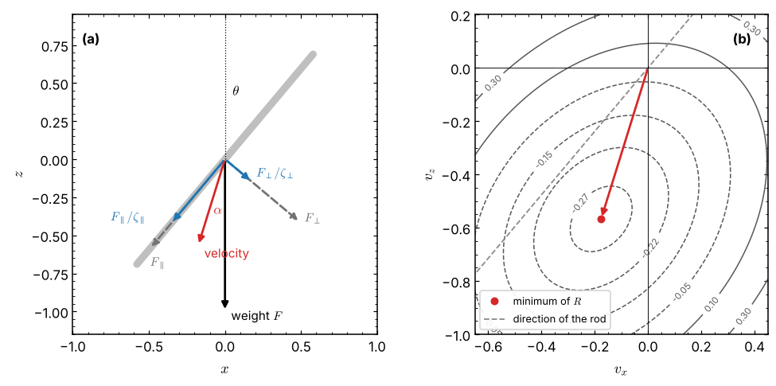
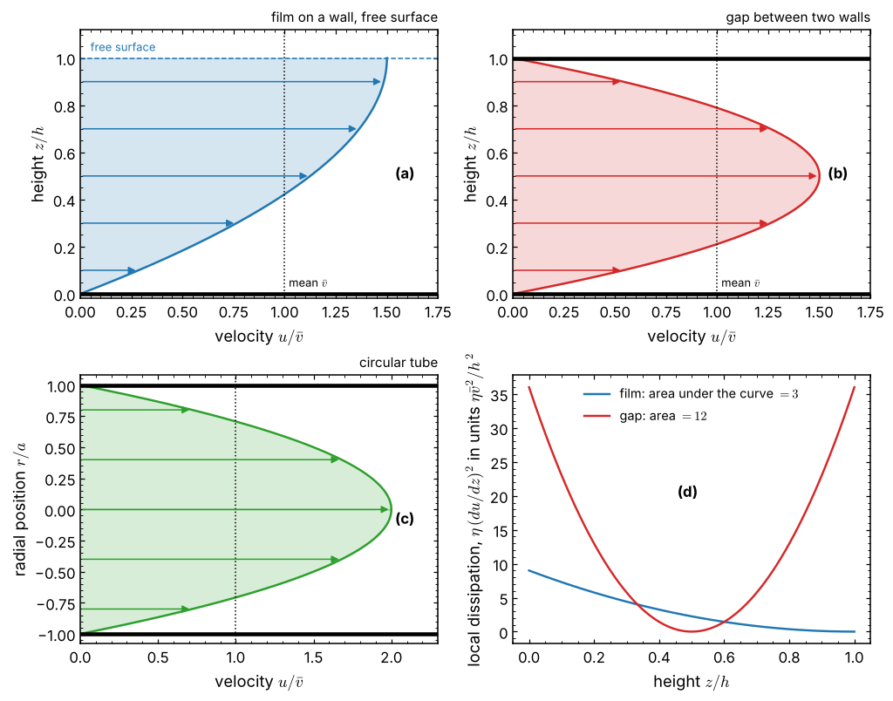
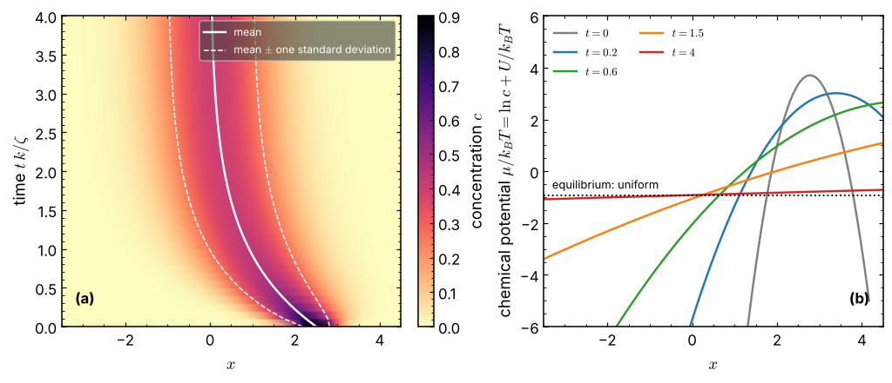
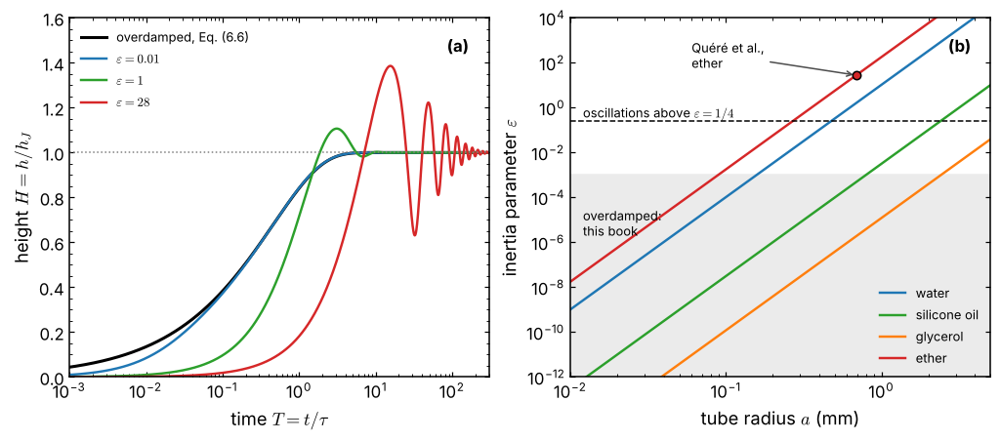
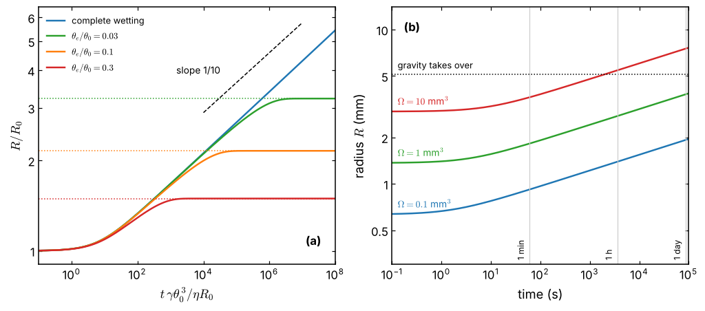

<div align="center">

# Variational methods in soft matter

**An open book on the Onsager principle, taught through worked problems — with every variational result
checked against an exact or numerical solution.**

[](https://github.com/ktwyw/onsager-variational-methods/actions/workflows/tests.yml)
[](https://ktwyw.github.io/onsager-variational-methods/)
[](pyproject.toml)
[](#whats-inside)
[](LICENSE)
[](DATA_LICENSE.md)


<sub>A partial differential equation replaced by one ordinary one. A solute diffuses into a liquid from a wall. The trial profiles have a single parameter, the penetration length ℓ(t), and the Onsager principle says how it grows. Both give the exact √(Dt) law; the amount taken up is 13 % high for a straight line and 1 % low for a cubic profile. (<code>scripts/make_readme_animation.py</code>)</sub>

</div>

The slow motion of soft matter (colloids, polymers, gels, liquid films, liquid crystals) is decided by a
balance between thermodynamic forces and friction. The Onsager principle states that balance as a
minimum: the rates of change are those that minimise the **Rayleighian**, the sum of the dissipation
function Φ and the rate of change of the free energy *A*. Two scalar functions replace a list of forces,
the resulting equations obey the second law and Onsager's reciprocal relations by construction, and a
minimum can be approached with trial functions when the exact solution is out of reach. This repository
teaches the method through worked problems. It currently contains **Part I: 5 executed Jupyter
notebooks** on the principle itself, the **first two chapters of Part II** (capillary rise and
imbibition; spreading of a droplet), **worked solutions to all 28 exercises** in [`solutions/`](solutions), a small tested Python module
(**`onsager`**), and a list of **[suggested references](docs/references.md)**. The rest of Part II and
Part III (soft materials) are in preparation.

> **Start in 60 seconds:** open [Chapter 1](notebooks/part1_principle/01_why_a_variational_principle.ipynb)
> here on GitHub (the notebooks are stored with their outputs), or go straight to
> [Chapter 5](notebooks/part1_principle/05_approximation_method.ipynb), where a diffusion problem is
> solved with one parameter and compared with the exact solution.

## Why this book?

- **One recipe, repeated.** Every problem is solved in the same steps: choose the slow variables, write
  the free energy *A*, write the dissipation function Φ, minimise Φ + d*A*/d*t*, solve and interpret.
- **Every result is checked.** Each variational result is compared with the exact or fully numerical
  solution of the same problem, so the reader sees how good a one- or two-parameter trial solution
  really is, and where it fails.
- **Pictures beside the theory.** Schematics, maps of the Rayleighian, velocity and flux fields are
  placed where the argument needs them: three figures in every chapter, more in the solutions.
- **Derivations are written out.** No step is left to the reader; the level is that of a physics or
  engineering graduate course, and no calculus of variations is assumed. Each chapter ends with four
  exercises, and every exercise has a sample solution, derived and then checked by computation.
- **Honest about accuracy.** Chapter 5 shows which outputs of a trial solution can be trusted (scaling
  laws, integrated quantities) and which cannot (local gradients, coefficients to better than a few per
  cent), including a case where adding a parameter does not improve the answer.

## What the checks show

<p align="center">

</p>

**(a)** The Rayleighian of a particle in a viscous fluid is a parabola in the velocity; its minimum is
the velocity the particle takes. **(b)** Flow in a square duct: one trial function gives the flow rate
to 1.2 %, always from below. **(c)** A slender rod settling in a viscous liquid drifts sideways, by at
most arcsin(1/3) = 19.5°. **(d)** Diffusion into a half-space: trial profiles with the penetration
length given by the Onsager principle.

| Check | Variational result | Reference | Agreement |
|---|---|---|---|
| Flow rate in a square duct, 1 trial function | 5/9 = 0.5556 | 0.5623 (series) | −1.2 % |
| Flow rate in a square duct, 15 trial functions | 0.562303 | 0.562308 | −0.001 % |
| Largest drift angle of a slender rod | 19.4712° (numerical search) | arcsin(1/3) | to 4 decimals |
| Squeeze film, gap against time | kinetic equation | Stefan's law, closed form | 10⁻¹¹ |
| Particles in a harmonic trap | finite-volume solution | exact Gaussian | error falls as Δx² |
| Energy balance of a non-ideal solution | ∫2Φ d*t* | *A*(0) − *A*(*t*) | 2 × 10⁻⁴ |
| Uptake by diffusion, straight-line profile | 1.279 √(*Dt*) | 1.128 √(*Dt*) | +13.4 % |
| Uptake by diffusion, cubic profile | 1.118 √(*Dt*) | 1.128 √(*Dt*) | −0.9 % |
| Capillary rise, kinetic equation | numerical solution | exact *t*/τ = −*H* − ln(1 − *H*) | 3 × 10⁻⁹ |
| Capillary rise, energy balance | ∫2Φ d*t* | *A*(0) − *A*(*t*) | 6 × 10⁻¹² |
| Spreading drop, radius over three decades of time | kinetic equation for *R*(*t*) | thin-film equation | within 2 % |
| Spreading drop, equilibrium radius (partial wetting) | (4Ω/πθ<sub>e</sub>)<sup>1/3</sup> | thin-film equation | 0.5 % |
| Spreading drop, coefficient of the logarithm | 6 | 9 (Cox–Voinov) | not captured by a cap-shaped trial profile |
| Viscous gravity current (exercise) | *R*⁸ = (2¹⁰/3⁵π³) ρ*g*Ω³*t*/η | Huppert's similarity solution | exact |

## Gallery

Each chapter has three figures: two beside the theory they illustrate, and one that collects the checks.

| | |
|---|---|
| <br>The Rayleighian as a map in position and velocity; the particle follows the line of minima ([Chapter 1](notebooks/part1_principle/01_why_a_variational_principle.ipynb)) | <br>Why an inclined rod drifts sideways: force diagram, and the same result as a minimum ([Chapter 2](notebooks/part1_principle/02_kinetic_equations.ipynb)) |
| <br>Velocity profiles in a film, a gap and a tube, and where the energy is dissipated ([Chapter 3](notebooks/part1_principle/03_writing_the_two_functions.ipynb)) | <br>Particles in a trap: the concentration in space and time, and the chemical potential flattening ([Chapter 4](notebooks/part1_principle/04_field_equations.ipynb)) |
| <br>The four steps of the approximation method: trial profile, implied flux, the Rayleighian against the rate, and the result ([Chapter 5](notebooks/part1_principle/05_approximation_method.ipynb)) | <br>Capillary rise: where the overdamped description holds and where the column oscillates ([Chapter 6](notebooks/part2_liquids_interfaces/06_capillary_rise.ipynb)) |
| <br>Tanner's law: the radius of a spreading drop grows as the tenth root of the time ([Chapter 7](notebooks/part2_liquids_interfaces/07_spreading_droplet.ipynb)) | |

## Installation

```bash
git clone https://github.com/ktwyw/onsager-variational-methods.git
cd onsager-variational-methods
pip install -e ".[notebooks]"
jupyter lab
```

The notebooks also run without installation: each one adds the repository root to the path if the
module is not installed.

## Quick start

```python
import sympy as sp
import onsager as on

# two reservoirs joined by a narrow tube: three rates, two constraints
h1, h2, q = sp.symbols("h1 h2 q")
hdot1, hdot2, Q, p1, p2 = sp.symbols("hdot1 hdot2 Q p1 p2")
S1, S2, rho_g, R_h = sp.symbols("S1 S2 rho_g R_h", positive=True)

A = rho_g * (S1 * h1**2 + S2 * h2**2) / 2      # gravitational energy
Phi = R_h * Q**2 / 2                           # dissipation in the tube

eq = on.kinetic_equations(A, Phi, [h1, h2, q], [hdot1, hdot2, Q],
                          constraints=[S1 * hdot1 + Q, S2 * hdot2 - Q], multipliers=[p1, p2])
print(eq[Q])     # rho_g*(h1 - h2)/R_h   Poiseuille's law
print(eq[p1])    # h1*rho_g              the multiplier is the hydrostatic pressure
```

## What's inside

**Part I. The principle** (available)

| Chapter | Topics | Checked against |
|---|---|---|
| [1. Why a variational principle](notebooks/part1_principle/01_why_a_variational_principle.ipynb) | the Rayleighian of a particle; minimum dissipation in Stokes flow; trial functions | force-balance solution; exact series for a square duct |
| [2. Onsager's kinetic equations](notebooks/part1_principle/02_kinetic_equations.ipynb) | friction matrix; reciprocal relations; d*A*/d*t* = −2Φ; a settling rod; two interacting spheres | closed-form drift angle; energy balance |
| [3. Writing the two functions](notebooks/part1_principle/03_writing_the_two_functions.ipynb) | catalogue of *A* and Φ; functional derivatives; Lagrange multipliers; the squeeze film | numerical derivative; exponential relaxation; Stefan's law |
| [4. From the principle to field equations](notebooks/part1_principle/04_field_equations.ipynb) | diffusion and the Einstein relation; Stokes; Darcy; Brinkman | exact solution in a harmonic trap; energy balance; exact channel profile |
| [5. The approximation method](notebooks/part1_principle/05_approximation_method.ipynb) | trial profiles; a dynamical shape parameter; the Onsager–Machlup integral; what to trust | exact error-function solution |

**Part II. Liquids and interfaces** (in progress)

| Chapter | Topics | Checked against |
|---|---|---|
| [6. Capillary rise and imbibition](notebooks/part2_liquids_interfaces/06_capillary_rise.ipynb) | Lucas–Washburn law; Jurin height; inertia and oscillations; imbibition into porous materials | exact solution of the kinetic equation; energy balance; Bosanquet's equation with inertia |
| [7. Spreading of a droplet](notebooks/part2_liquids_interfaces/07_spreading_droplet.ipynb) | the unbalanced Young force; friction of a liquid wedge and its logarithm; Tanner's law; partial wetting; the thin-film equation | numerical solution of the thin-film equation with a precursor film; Cox–Voinov law |

In preparation: coalescence and sintering of viscous drops; a drying droplet.

Sample solutions: [Chapter 1](solutions/part1_principle/01_solutions.ipynb) ·
[2](solutions/part1_principle/02_solutions.ipynb) ·
[3](solutions/part1_principle/03_solutions.ipynb) ·
[4](solutions/part1_principle/04_solutions.ipynb) ·
[5](solutions/part1_principle/05_solutions.ipynb) ·
[6](solutions/part2_liquids_interfaces/06_solutions.ipynb) ·
[7](solutions/part2_liquids_interfaces/07_solutions.ipynb).

**Part III. Soft materials** (in preparation): diffusion and sedimentation of colloids; swelling and
squeezing of a gel; phase separation; polymer dynamics; nematic liquid crystals.

## The `onsager` module

| Function | Purpose |
|---|---|
| `rayleighian`, `friction_matrix` | the Rayleighian Φ + d*A*/d*t* and the friction matrix, in SymPy |
| `kinetic_equations` | minimise the Rayleighian over the rates, with constraints and Lagrange multipliers |
| `rate_function` | turn the result into a right-hand side for `scipy.integrate.solve_ivp` |
| `flux_from_rate`, `friction_matrix_1d` | friction matrix of the parameters of a trial concentration profile |
| `smoluchowski_fv` | conservative finite-volume solver for one-dimensional diffusion with interactions and an external potential |
| `thin_film_fv` | conservative finite-volume solver for the thin-film equation (drop or ridge, precursor film, partial wetting, gravity) |
| `duct_flow_rate`, `duct_velocity` | exact flow in a rectangular duct |
| `sup_error`, `relative_error`, `loglog_slope` | comparison with a reference solution |
| `fit_cap` | apparent height, radius and contact angle of a thin drop |
| `use_style`, `panel_label` | the plotting style of the figures |

Run the tests with `pytest -q` (20 tests).

## Repository layout

```
onsager/                     the Python module
notebooks/part1_principle/   Chapters 1-5, executed
notebooks/part2_liquids_interfaces/   Chapters 6-7, executed
solutions/                   sample solutions to the exercises, executed
tests/                       tests of the module
scripts/                     scripts that draw the figures of this page
docs/                        introduction, notation and references of the book; images
myst.yml                     Jupyter Book 2 configuration
```

## Suggested references

The notebooks are self-contained and do not follow any book. For further study, see the list in
[docs/references.md](docs/references.md), which starts with M. Doi, *Soft Matter Physics* (Oxford
University Press, 2013) and M. Doi, "Onsager's variational principle in soft matter", *J. Phys.:
Condens. Matter* **23**, 284118 (2011).

## Companion books

- [math-perturbation-methods](https://github.com/ktwyw/math-perturbation-methods): perturbation methods
  for differential equations.
- [math-asymptotic-methods](https://github.com/ktwyw/math-asymptotic-methods): asymptotic expansions of
  integrals and sums.
- [error-analysis](https://github.com/ktwyw/error-analysis): evaluating, propagating and reporting
  uncertainty.

## Scope and limitations

- The book treats isothermal systems close to equilibrium, with negligible inertia and a dissipation
  function that is quadratic in the rates. `kinetic_equations` refuses a dissipation function that is
  not quadratic.
- Thermal fluctuations are not treated: the equations are for mean values.
- The hydrodynamic interaction of Chapter 2 is the leading far-field term, not valid for nearly
  touching spheres.
- Chapter 6 assumes a Poiseuille flow along the whole liquid column and a static contact angle; its
  Section 6.4 shows when the inertia of the liquid makes the overdamped description fail.
- Chapter 7 is for thin drops (small slopes) without gravity, with a microscopic cut-off at the contact
  line. The cap-shaped trial profile gives the exponents of Tanner's law and the radius to a few per
  cent, but the coefficient of the logarithm in the friction is 6 where the exact one is 9
  (Section 7.6).
- The dissipation function of the Brinkman equation in Chapter 4 uses the viscosity of the liquid; in a
  real porous medium the coefficient is an effective viscosity.
- Trial solutions are approximations. Their accuracy is examined case by case, and Chapter 5 explains
  what can be trusted.

## Roadmap

- The rest of Part II (Chapters 8–9) and Chapters 10–11 of Part III, to complete the first release.
- Chapters 12–14: phase separation, polymer dynamics, nematic liquid crystals.
- Later: dissipation functions that are not quadratic, and error estimates for trial solutions.

## Author

**Yanwei Wang**, Department of Chemical and Materials Engineering, School of Engineering, Nazarbayev
University, Astana, Kazakhstan · yanwei.wang@nu.edu.kz ·
ORCID [0000-0002-8488-9833](https://orcid.org/0000-0002-8488-9833)

## Citing

Please cite the material using the metadata in [`CITATION.cff`](CITATION.cff).

## License

Code (`onsager/`, `tests/`, `scripts/` and the code cells of the notebooks): [MIT](LICENSE). Text,
figures and notebook outputs: [CC BY 4.0](DATA_LICENSE.md).
